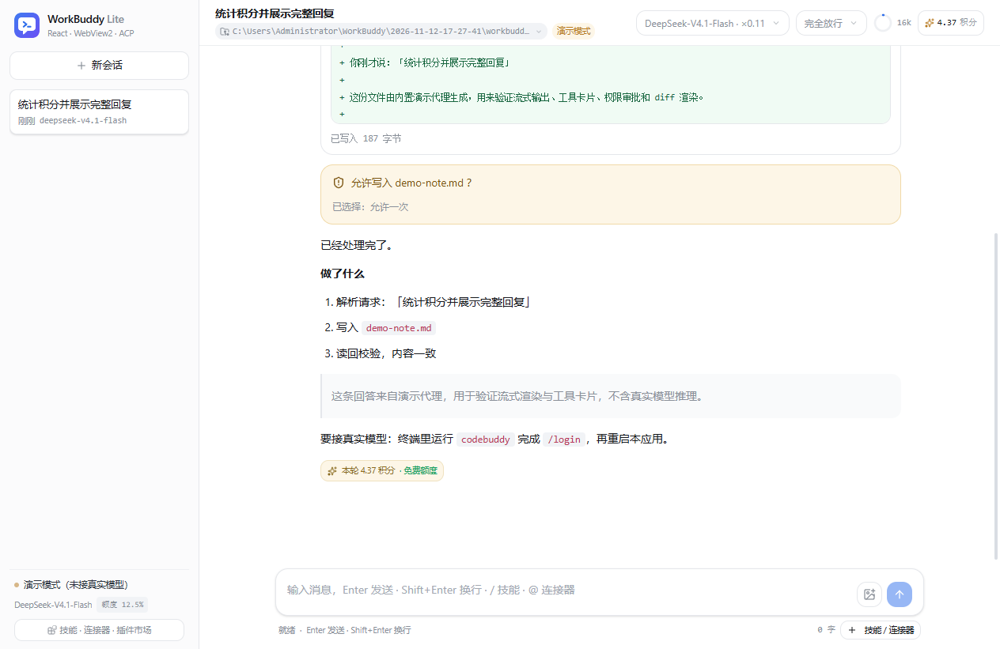
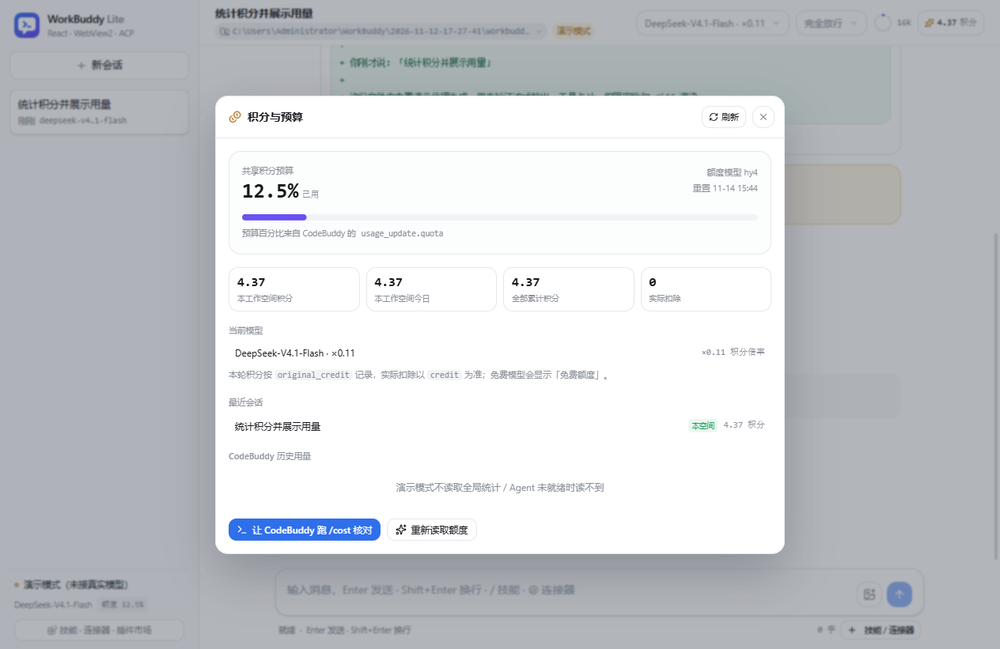
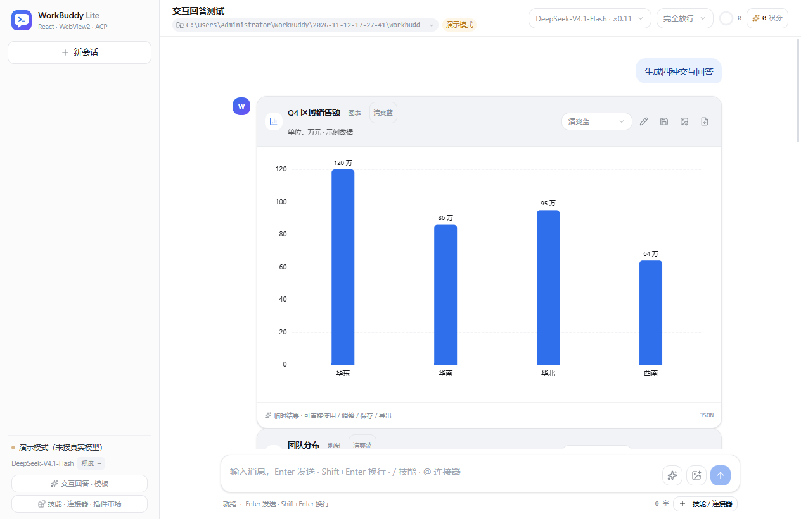
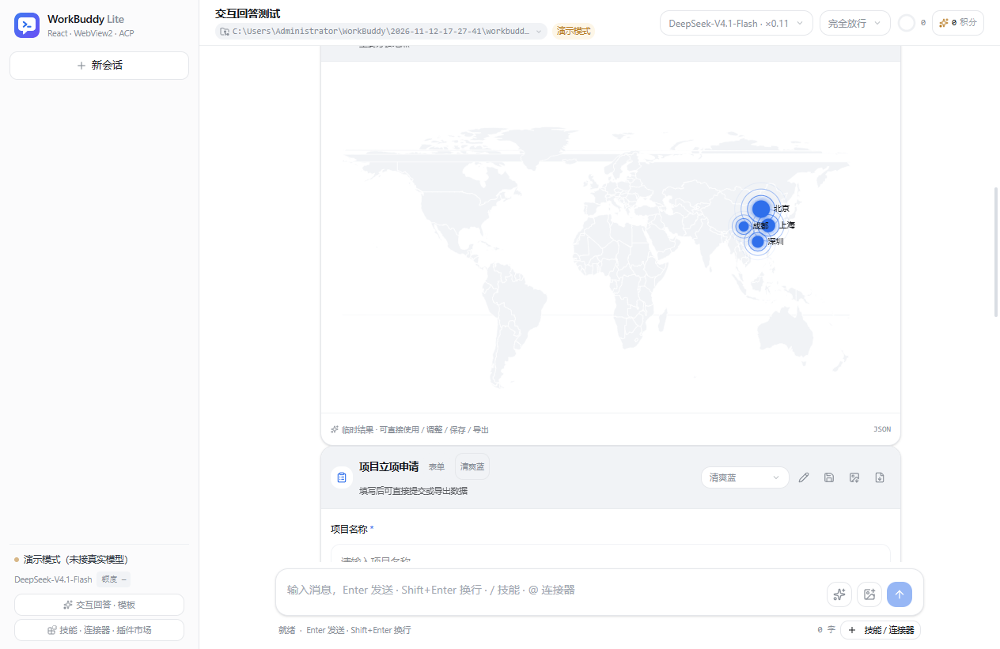
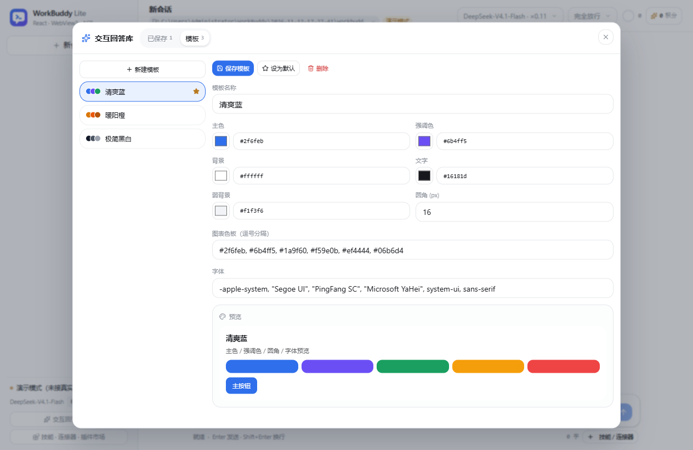
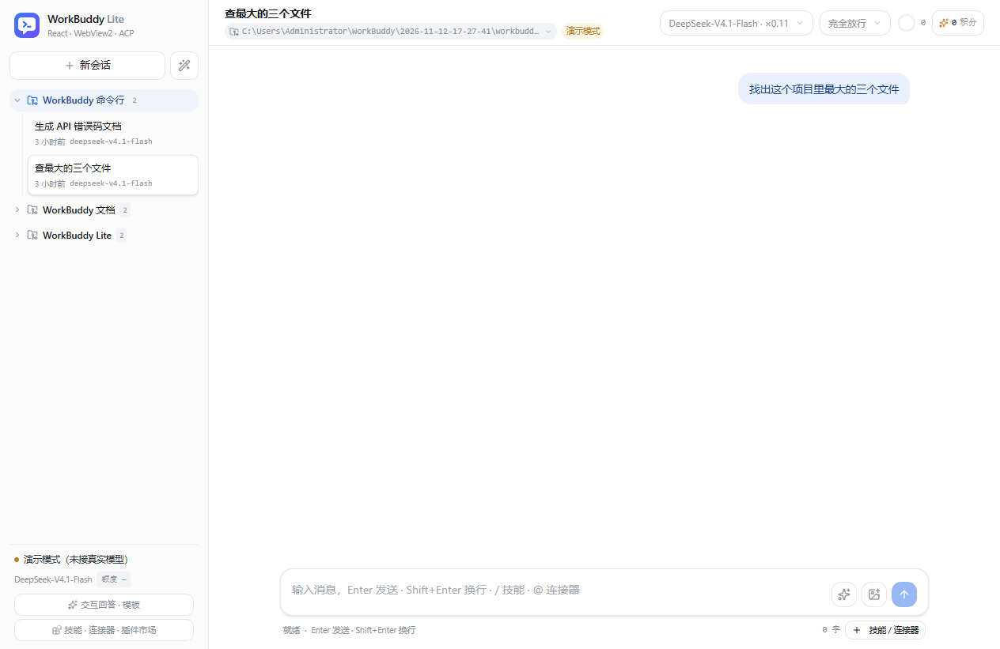

# WorkBuddy Lite

一个用 **C++17 + WebView2** 写的轻量版 WorkBuddy：本地 Win32 单进程，内嵌 HTTP 服务与 WebView2 界面，
通过 **ACP（Agent Client Protocol）** 驱动本机的 `codebuddy` CLI 干活。

只做三件事：把话递给 CodeBuddy、把工具调用画清楚、把权限交回你手里。

## Android 定制（开发预览）

安卓端采用 React Native + Termux 本地 CodeBuddy CLI。已加入原生客户端、Termux 安装/登录入口、本地 bridge 与会话恢复；使用方法见 [Android 客户端指南](docs/android-mobile.md)，底层验证见 [P0 指南](docs/android-p0.md)，总体计划见 [#2](https://github.com/Wike-CHI/workbuddy-lite/issues/2)。当前为开发预览，真实手机的完整兼容性仍待验收。

## 能力

- **模型选择**：从 ACP `session/new` 的 `availableModels` 读模型目录（带 `×0.11` 这类积分倍率），
  顶栏直接切换；切换走 `session/set_config_option(configId=model)`，会话级生效。
- **积分与预算**：解析 `usage_update` 里的 `credit` / `original_credit` / `quota`，
  顶栏显示累计积分，每条回答末尾显示「本轮 N 积分」，点积分徽标看预算百分比、
  重置时间、本工作空间/今日/累计用量，以及 CodeBuddy 的历史会话与 Token 统计。
- **工作空间读取**：合并 CodeBuddy 的最近工作空间（`/api/v1/sessions/workspaces`）、
  `~/.codebuddy/projects` 与 `~/.workbuddy/projects` 里的历史项目（扫描 session jsonl 的 cwd）、
  本地会话目录、当前目录子目录和自建项目（`projects.json`）；支持筛选、系统目录选择器、
  当前窗口切换、独立新窗口打开。
- **多文件夹工作空间**：自建工作空间是「名字 + 最多 5 个文件夹」，可改名、加/减文件夹、删除分组；
  cwd 取第一个文件夹，其余目录写进 prompt 交给模型按绝对路径访问，并记住上次选择。
- **右侧工作台**（`Ctrl B` 开合，可拖宽）：文件树、变更 diff、计划、待办、Git（暂存 / 取消 / 提交）、
  子智能体与后台任务、内嵌浏览器；右上角还有「详情」（文件夹改动归属、模型、上下文、积分）和「分享」（本地导出 Markdown / HTML、复制）。
- **多窗口 / 项目分组**：侧栏按 cwd 把会话分到项目组，当前项目展开；项目组可直接新建会话或
  新窗口打开。每个窗口一个进程、一个 ACP 会话；WebView2 数据目录按 PID 隔离，
  `sessions.json` 用命名互斥锁串行化并做跨进程合并，后写的窗口不会覆盖先写的会话。
- **AI 整理**：侧栏魔法棒让 CodeBuddy 根据会话内容优化项目名、给会话起标题；先预览、可勾选，
  应用后才写入 `projects.json` 和会话标题。整理使用临时 ACP 会话，不会在聊天里留下一条记录。
- **任务托盘 / 任务栏图标**：`src/app.ico`（16 / 32 / 48 / 64 / 128 / 256）编译进 exe 资源，
  资源管理器、任务栏、托盘、Alt+Tab 共用同一套图标；托盘支持双击/单击恢复、
  右键菜单（显示/隐藏、新建窗口、打开工作目录、退出）；Explorer 重启后自动重新注册托盘图标。
- **输入框**：按会话保存草稿、↑ 调历史、字数统计、中文输入法不抢 Enter、空内容禁用发送、
  Ctrl+K 聚焦，拖拽/粘贴图片与 `/` `@` 弹层保持原样。
- **文件预览**：工具产物里的 DOCX / XLSX / PPTX / PDF 可以点开预览（docx-preview、
  SheetJS、pptx-preview），图片支持缩放灯箱，视频/音频直接内嵌播放；只读当前工作空间内的文件。
- **交互回答（intelligent-ui）**：聊天里出现 ```iui 代码块时，直接渲染成图表 / 地图 / 表单 / 文章；
  支持自定义视觉模板、按需生成、调整 JSON、保存到交互回答库，以及导出 PNG 或独立交互 HTML 页面。

| 新前端（React + assistant-ui） | 积分与预算面板 |
|---|---|
|  |  |

| 交互回答：图表 | 交互回答：地图 | 模板管理 |
|---|---|---|
|  |  |  |

| 按 workspace 分组的项目侧栏 |
|---|
|  |

```
┌─────────────────────────────────────────────┐
│ workbuddy-lite.exe (Win32)                  │
│                                             │
│  ┌──────────────┐      ┌─────────────────┐  │
│  │ WebView2     │◄────►│ 本地 HTTP 服务    │  │
│  │ (React/Vite) │ HTTP │ 127.0.0.1:随机端口│  │
│  └──────────────┘      └────────┬────────┘  │
│                                 │ ACP       │
│                        ┌────────▼────────┐  │
│                        │ AcpClient      │  │
│                        └────────┬────────┘  │
└─────────────────────────────────┼───────────┘
                                  │ HTTP + JSON-RPC(SSE)
                        ┌─────────▼─────────┐
                        │ codebuddy --serve │  子进程，随主程序启停
                        └───────────────────┘
```

## 编译

需要 Visual Studio 2022（含 C++ 桌面工具链）和 WebView2 Runtime（Win11 / 装了 Edge 的 Win10 自带）。
改前端时还需要 Node.js 20+。

```bat
build-web.bat   :: React/Vite → web/
build.bat       :: C++ → bin\workbuddy-lite.exe，并把 web/ 拷到 bin\web
```

产物：`bin\workbuddy-lite.exe` + `bin\web\`（前端静态资源）。`build.bat` 会先用 `rc.exe` 编译
`src\app.rc`（16–256 多尺寸应用图标），再链接 C++。

前端源码在 `frontend/`（React 19 + Vite + TypeScript + Tailwind 4 + shadcn/ui + assistant-ui），
`build-web.bat` 会把它构建到 `web/`，`build.bat` 再把 `web/` 拷进 `bin\web`。
运行时仍然从磁盘读，不编进 exe：源码树里优先用 `bin\..\web`，找不到才退回 exe 同级的
`bin\web`；静态响应带 `Cache-Control: no-store`。分发包把 `bin` 整个拷走即可。
旧的原生 HTML/CSS/JS 前端备份在 `web-legacy/`，需要回退时把内容拷回 `web/` 即可。

## 运行

```bat
bin\workbuddy-lite.exe                 :: 真实模式
bin\workbuddy-lite.exe --demo          :: 演示模式，不需要登录
bin\workbuddy-lite.exe --cwd D:\repo   :: 指定工作目录
bin\workbuddy-lite.exe --web D:\ui     :: 指定前端目录（默认按上面规则自动找）
bin\workbuddy-lite.exe --cwd D:\repo --new-window  :: 新窗口不续接上次会话
```

真实模式下程序会自己拉起 `codebuddy --serve --port <随机> --host 127.0.0.1`，
退出时连带杀掉整棵进程树。**前提是本机 codebuddy 已登录**（终端里跑 `codebuddy` 再 `/login`），
或者环境里给了 `CODEBUDDY_API_KEY`。没登录时界面会明确告诉你去登录，而不是静默失败。

界面里的「工作空间」可以从最近项目、当前目录子目录或系统目录选择器里挑；
「切换」改本窗口后续会话的 cwd，「新窗口」会再起一个 `workbuddy-lite.exe`。

工作空间是**一个名字 + 最多 5 个文件夹**（存在 `workspaces.json`）：面板里「新建 / 编辑」可以改名、
加文件夹（系统选择器自带「新建文件夹」）、移除文件夹，删除只删分组不删目录。
cwd 取第一个文件夹，其余文件夹会写进 prompt，让模型知道还能按绝对路径访问；
`/api/file` 也放开到整个工作空间。

「切换」「新建」「保存」都会把选择写进 `settings.json` 的 `lastWorkspace` / `lastWorkspaceId`；
没有选择记录时，启动会跟随最近一次会话所在目录，而不是 exe 所在目录。
同一台机器上多开时，`sessions.json` 会做跨进程合并，但侧栏只显示当前 cwd 的会话。

设置 `WORKBUDDY_LITE_DATA` 可以把会话/图片指到别的目录，方便测试或多套环境隔离：

```bat
set WORKBUDDY_LITE_DATA=D:\wbl-data && bin\workbuddy-lite.exe --demo
```

## 目录

```
src/
  main.cpp        Win32 窗口 + WebView2 宿主（含 --auto/--shot 调试钩子）
  backend.cpp     本地 HTTP 服务：静态页面、会话持久化、事件长轮询、权限回传
  acp_client.cpp  ACP 客户端：connect / subscribe / JSON-RPC 双向
  agent_host.cpp  拉取并守护 codebuddy --serve 子进程
  catalog.cpp     扫本地技能 / MCP 连接器 / 插件市场清单
  normalize.cpp   ACP session/update → 前端事件
  common.cpp      日志、UTF-8 工具、事件总线
  app.rc          应用图标资源（链接 app.ico，16–256 多尺寸）
  app.ico         蓝色渐变聊天/代码图标
web/              构建产物（index.html + assets/ + icon.svg）
web-legacy/       旧原生前端备份
frontend/         React 源码：src/components（files/ Office 预览、intelligent/ 交互回答）、src/store、src/lib
third_party/      httplib.h、json.hpp、WebView2 SDK
```

## 几个实现上的取舍

**前端用 React + assistant-ui，而不是继续手写 DOM。** 会话列表/顶栏/弹窗是 shadcn/ui +
Tailwind，消息流交给 `@assistant-ui/react` 的 `useExternalStoreRuntime`：把 ACP 事件归约成
`ThreadMessageLike`，文本/思考/工具调用用它的 message parts 渲染，计划、权限、积分、错误
则用 `data-*` 自定义 part。这样自动滚动、复制、流式 Markdown、附件输入框都由库接管，
自研代码只保留 ACP 适配和权限/积分这些业务卡片。

**AI 输出单独走 Markdown 管线。** `@assistant-ui/react-markdown` + `remark-gfm` +
`remark-math` + `rehype-katex` + `rehype-highlight`，代码块用 highlight.js，Mermaid 用
`componentsByLanguage` 单独渲染；这样模型输出里的表格、公式、图表、代码都能直接看。

**Mermaid / KaTeX / highlight.js 按需加载。** 消息里出现公式才 `import('rehype-katex')` 和
KaTeX CSS，出现 ``` 代码块才 `import('rehype-highlight')`，出现 ```mermaid 才
`import('mermaid')`。首屏只加载主 JS 和主 CSS，首包从 1.59MB 降到约 1.0MB（gzip 约 309KB），
KaTeX/Mermaid 的字体和图表 chunk 在真正需要时才请求。

**Office 预览也按需加载，并且只读工作空间。** 工具产物里的路径会通过 `GET /api/file?path=`
读取；后端用 `weakly_canonical` 做前缀校验，只允许当前 cwd 内的文件，并支持视频 Range。
docx-preview / SheetJS / pptx-preview 都是点击预览时才 `import()`，图片/视频走原生组件，
PPT 遇到不支持的复杂版式会降级成「下载原文件」而不是黑屏。

**交互回答用一层轻量 JSON 协议。** 模型输出 ```iui 代码块，前端用
`componentsByLanguage.iui` 接管渲染，而不是把 JSON 当代码显示。ECharts（图表/地图）、
world-atlas、html-to-image、marked 全部按需加载；模板和已保存结果写到
`%LOCALAPPDATA%\WorkBuddyLite\intelligent-ui.json`，跨窗口和重启都能读到。
导出交互页面时把 ECharts UMD、地图 GeoJSON 和主题 CSS 内联，离线打开也能交互。

## 交互回答

输入框右侧的 ✨ 按钮会打开「生成交互回答」：选类型（图表 / 地图 / 表单 / 文章）、视觉模板，
写一句需求后点「生成并发送」，CodeBuddy 会返回到一个 ```iui JSON 代码块，聊天里直接渲染。
也可以手动把下面这种 JSON 贴进消息：

```iui
{"type":"chart","title":"Q4 销售","chart":{"kind":"bar","categories":["华东","华南"],"series":[{"name":"销售额","data":[120,86]}],"unit":" 万"}}
```

组件右上角依次是：模板切换、调整 JSON、保存到交互回答库、导出 PNG、导出独立 HTML。
侧栏的「交互回答 · 模板」可以查看已保存结果、管理视觉模板；临时结果不保存也不会影响原始消息。

**用 ACP 而不是解析 CLI 的 stdout。** `codebuddy --serve` 暴露 `/api/v1/acp`（JSON-RPC over SSE），
有会话、流式更新、权限反向请求，比刷 `-p --output-format stream-json` 稳得多。

**每个 JSON-RPC 请求自带一段 SSE。** POST 的响应体本身就是 `:ok` + `event: message` 帧，
同时订阅流也会推同样的响应，所以客户端按 `id` 去重，两边谁先到都行。

**事件通道用长轮询，不用 SSE。** 客户端完全掌握 `from` 游标，断线重连不会重放或丢事件；
SSE 在 WebView2 里断过一次，重连会从头刷一遍，反而更难处理。

**多字节字符必须按码点切。** 早期版本按字节切流式文本，切断半个汉字会让 `json::dump()`
直接抛异常，整个接口 500。现在统一走 `utf8Truncate` / 码点推进 + `dumpJson` 的 replace 兜底。

**`json::value()` 遇 null 会抛。** 前端传 `sessionId: null` 就能把接口打成 500，
所以所有外部输入都走 `jstr` / `jval`。

**会话 id 有两套，必须归一化。** ACP 的 `sessionId`（`01a1cf66-…`）和本地的
`uiId`（`s_xxxxxxxx`）不是一回事。`normalizeUpdate()` 打的是 ACP id，而前端按 UI id
过滤事件——刚开始 `usage` 这类带 `sessionId` 的载荷全被当成"别的会话"丢掉，
表现就是用量环永远不动。现在在 `wireAgentCallbacks` 里统一改写成 UI id，
事件流响应另外带上事件级 `sessionId` 兜底。

**演示模式是协议级 mock。** 它产出和真实 ACP 同构的 update，走同一条渲染路径，
用来在没有登录态时验证界面，不是假界面。

**模型目录只认 `session/new` 的返回。** `codebuddy --serve` 没有独立的“列模型”REST，
ACP 的 `session/new` 结果里同时带 `models.availableModels`（含 `_meta.credits` 倍率）和
`configOptions`。点开模型菜单时后端按需建一个会话做探测，首个真实会话会复用它，不额外浪费一次启动。

**积分按 `requestId` 去重。** 一轮请求会连发多条 `usage_update`，有的没有 `cost`，
真正的积分在 `_meta.usage.credit`（实扣）和 `_meta.usage.original_credit`（原价），
预算在 `_meta.usage.quota.percent` / `reset_at`。用 requestId 记住上次值、只累加增量，
否则每来一条 usage 都会把积分翻倍。

**agent 的两个慢接口要缓存。** `/api/v1/stats` 会扫全部历史会话（0.9–1.2s），
`/api/v1/sessions/workspaces` 也是现算的（0.4–0.6s）。前端每轮对话要读好几次用量，
直接同步转发会把 httplib 的线程池占满、界面发消息都变卡。现在这两个接口在后端缓存 60s，
过期后先返回旧值再后台刷新；启动时顺带预热一次。实测 `/api/usage` 985ms → 15ms，
`/api/workspaces` 430ms → 15ms。带 hash 的 `/assets/*` 也改成一年强缓存，其余仍是 `no-store`。

**工作空间不只读 agent 的最近列表。** `/api/v1/sessions/workspaces` 只是最近列表；
`~/.codebuddy/projects` 和 `~/.workbuddy/projects` 里还有大量历史项目，目录名是编码过的路径，
所以后端会扫描每个项目里 session jsonl 的 `cwd` 字段还原真实路径，并读
`~/.workbuddy/workspace-display-names.json` 补显示名。结果按 60 秒缓存，避免每次打开
工作空间面板都扫盘。换目录用 `session/new` 的 `cwd`，不需要重启后端；新窗口是另一个进程，
`--new-window` 让它不续接上一个会话。

**一个工作空间可以有 5 个文件夹，但 ACP 只有一个 cwd。** 自建工作空间存在
`workspaces.json`（`{id, name, folders[]}`），切过去时 cwd 取 `folders[0]`；
多个文件夹时，prompt 前面会加一段「本工作空间还包含这些目录」的说明，模型需要时按绝对路径访问，
`/api/file` 的越界检查也从「cwd 之内」放宽到「任一文件夹之内」。
同一主文件夹不允许出现在两个工作空间里，避免列表出现两条一样的；改名会同步写回
`projects.json`，侧栏分组标题跟着变。

**右栏的浏览器是第二个 WebView2，不是 iframe。** 前端把自己占位 div 的
`getBoundingClientRect()`（CSS px）和 `devicePixelRatio` 通过
`window.chrome.webview.postMessage` 发给宿主；宿主建一个 `WS_CHILD` 子窗口，
在该子窗口上 `CreateCoreWebView2Controller`，用物理像素 `SetWindowPos`、DIP 设
`put_Bounds`，所以 WebView2 完全独立于主界面（`X-Frame-Options` 管不到），切 tab 时
`ShowWindow(SW_HIDE)`。导航 / 前进后退 / 刷新由页面发消息，宿主把
`browser-state`（url、title、canGoBack）回传。`--winshot` 用 `PrintWindow` 截整窗，
因为 WebView2 的 `CapturePreview` 拍不到子窗口。

**Git 面板直接调 git CLI。** 后端用 `CreateProcessW` + 管道跑
`git -C <folder> status --porcelain=v1 --untracked-files=all` 和 `git diff`，给 2 秒缓存；
暂存/取消走 `git add -A --` / `git restore --staged --`，提交只接受 `-m`（不弹编辑器、
不跳过 hooks）。未跟踪文件没有 diff，后端按「全部新增」合成一份。
非 git 目录降级为提示，不影响会话里工具自己的 diff 展示。

**图标走 .ico 资源，GDI+ 只做兜底。** `src/app.rc` 把 `src/app.ico` 链接进 exe，资源管理器、
任务栏、托盘、Alt+Tab 都读同一套 16–256 图标；窗口和托运用 `LoadImageW` 取资源，资源缺失时
才用 GDI+ 画蓝色 W。任务栏图标通过 `WM_SETICON` + 进程 AUMID 设置，托盘用
`Shell_NotifyIcon` 注册，`TaskbarCreated` 消息负责 Explorer 重启后的重注册；
菜单里的“新建窗口”和“打开工作目录”都取后端当前 workspace，而不是进程启动目录。

**侧栏按 cwd 分组，AI 整理不污染聊天。** `bootstrap` 返回所有会话的 cwd，侧栏按 cwd 分组；
加载另一个项目的会话时会顺手把当前工作空间切过去，新会话和后续工具调用都落在正确目录。
AI 整理走后端临时 ACP 会话，只收集 `agent_message_chunk` 的文本；返回的 JSON 先给前端预览，
用户点应用后才 rename 会话、写 `projects.json`。当前 CLI 不支持 `session/delete` / `session/close`，
所以临时会话留在 agent 侧，但它不进 `sessions.json`、不出现在列表里，不影响使用。

**多窗口共用一份 `sessions.json`。** 每个进程启动时各读一份，写之前用
`Local\WorkBuddyLiteStore` 命名互斥锁串行化，并把磁盘上的新会话合并回来；
删除用 tombstone 记录，避免刚删的会话被另一个窗口的旧快照复活。

**流式事件落盘前先合并，单会话最多 400 条。** ACP 的 `agent_message_chunk` 是逐 token 的，
原样 push 进 `events` 会让一个长会话攒到十几万条——实测一份 `sessions.json` 涨到 25 MB、
`bootstrap` 每次都要深拷贝整份事件数组，界面就会卡住甚至发不出下一轮。
现在相邻的 `text`/`thought` 会被并成一条（单条上限 64 KB），写入时超过 800 条就压回 400 条，
同时保留最早两条和最近对话；启动时也会把老数据统一压一次。
`bootstrap` 不再深拷贝 `events`，`/api/sessions/:id` 只回最近 400 条并带 `truncated`。

**技能 / 连接器 / 插件市场都读本地配置，不另建索引。** 技能是项目与用户目录下的
`SKILL.md`（只摘 frontmatter 的 name / description / argument-hint），连接器来自各层
`mcp.json` 的 `mcpServers`，插件市场来自 `known_marketplaces.json` 与
`installed_plugins.json`。安装/启用按钮不自己写配置，而是把 `/plugin …` 作为一条普通
prompt 交给 CLI，让 CLI 自己走它的安装流程和鉴权。

**图片走 ACP 的 image 内容块。** 前端把文件转成 base64，后端解码落盘到
`%LOCALAPPDATA%\WorkBuddyLite\images`，事件里只存 `/api/images/xxx` 这条 URL；
prompt 里再以 `{type:image, mimeType, data}` 传给模型，文字放在图片之后，先看图再读要求。

## 边界

- 单窗口单工作空间：侧栏只显示当前 cwd 的会话，换工作空间请用「切换」或「新窗口」。
- 工作空间的 cwd 只有第一个文件夹：其余文件夹靠 prompt 说明 + 绝对路径访问，工具仍以 cwd 为基准。
- 单会话串行：一次只跑一个 prompt，`/api/cancel` 走 `session/cancel`。
- 积分/额度来自 `usage_update`，**发过一轮对话之后才有数据**；`quota.percent` 是
  CodeBuddy 返回的共享预算百分比，本应用只展示不修改。
- 多窗口的会话文件是「合并写」而不是数据库事务：两个窗口同时改同一条会话时，后写的
  版本会覆盖先写的；不同会话之间不会互相覆盖。
- 只处理 `session/request_permission` 这一种反向请求，文件读写代理等一律空回。
- 历史会话换了进程后靠 `session/load` 续上；agent 不支持时会退化成新会话。

## 调试开关

```bat
:: 旧原生前端：往输入框打字并点发送
bin\workbuddy-lite.exe --demo --auto "随便说点什么" --wait 8000 --shot out.png

:: React 前端：用 window.__wbl 钩子发消息，再点开积分面板截图
bin\workbuddy-lite.exe --demo --eval "setTimeout(function(){window.__wbl.send('看积分')},1500)" --wait 38000 --click credit-btn --click-at 34000 --shot usage.png
```

`--auto` 会真的往输入框里打字并点发送（旧前端）；React 前端的输入框由 assistant-ui 托管，
更适合用 `--eval` 调 `window.__wbl.send(text)` / `openUsage()` / `openWorkspace()` / `openMarket()`，
或者 `window.__wbl.setComposerText("/")` 触发 `/` `@` 弹层。
`--wait` 后调用 WebView2 的 CapturePreview 存图并退出；`--click` / `--click-at` 在等待期间
点一下指定 id 的元素（例如 `credit-btn`、`cwd-chip`）。
日志在 `bin\data\app.log`；设置了 `WORKBUDDY_LITE_DATA` 时日志也落到该目录，方便并行测试。
